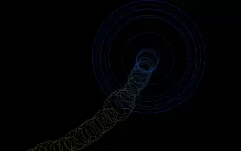
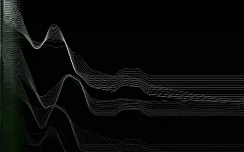
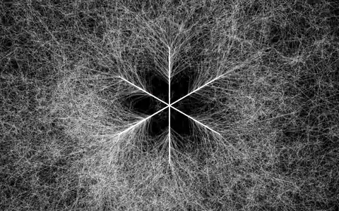

# p5-audio-visualizers

Fullscreen audio-reactive p5.js sketches.

**[Open the live demo](https://lucidbeaming.github.io/p5-audio-visualizers/)**

| conical | polygons |
|---|---|
|  |  |
| **mountains** | **coverage** |
|  |  |

Four sketches for live visuals alongside music, first made in 2017 and rebuilt in 2026. Open the page, pick a sketch, and it listens to the microphone (or plays an audio file) and draws from the spectrum and level of what it hears. Keys switch sketches, go fullscreen and hide the controls, so it can run on a projector during a set.

| Sketch | What it draws |
|---|---|
| `conical` | Rotating FFT polygons that spiral out from an off-centre point |
| `polygons` | Falling polygons, one per frequency bin, that grow and slow with the sound |
| `mountains` | A spectrum ridge that scrolls down the screen, leaving a range of ridgelines behind it |
| `coverage` | Branching trees that grow with the input level and slowly cover the screen |

## Requirements

- A current Chrome, Firefox or Safari (desktop or mobile)
- A microphone, or an audio file to play
- To run it yourself: any static file server. There's no build step and nothing to install.

## Run locally

```bash
git clone https://github.com/lucidbeaming/p5-audio-visualizers.git
cd p5-audio-visualizers
npx serve -l 8765          # or: python3 -m http.server 8765
```

Then open <http://localhost:8765/>. It has to be served: opening `index.html` as a `file://` page doesn't work, because browsers block ES modules there, and they only allow mic access on HTTPS or `localhost`.

## Usage

Pick a sketch on the start screen. Clicking it starts the sketch and asks for the microphone. With no mic (or if access is blocked), choose **Play an audio file instead**.

Every sketch has its own link: `…/#mountains` (or `…/?sketch=mountains`). The 2017 page names, like `mountains.html`, still work and forward to the player.

| Key | Action |
|---|---|
| `←` `→` | Previous / next sketch |
| `1`–`4` | Jump to a sketch |
| `F` | Fullscreen |
| `H` | Hide the controls and the cursor (press again to show them) |
| `Space` | Freeze the frame |
| `+` `-` | Input sensitivity, 2 dB per press |

The panel in the top-left corner shows the sketch, an input level meter and an **Input** menu, and fades after a few seconds without mouse movement. The Input menu switches between the default mic, any other audio input, and an audio file. You can also drop an audio file anywhere on the page.

**Sensitivity.** The mic is opened without the browser's voice processing (echo cancellation, noise suppression, auto-gain), so the sketches see the music as it is. The default sensitivity of +20 dB suits a mic across a room. If the meter turns red, press `-`; if the sketches barely move, press `+`. Files play at line level and are turned down 20 dB before the sensitivity setting, so the same default works for them. The setting is remembered in the browser.

## How it works

- **One page, one p5 instance.** [`index.html`](index.html) loads p5.js and p5.sound from [`vendor/`](vendor/), then [`src/main.js`](src/main.js) as an ES module. It creates one p5 instance (instance mode) and one canvas, and swaps sketches inside it when the URL hash changes. Creating a new p5 instance per sketch would mean removing the old one, and p5.sound disposes every sound object, including the mic, when an instance is removed.
- **One audio engine.** [`src/audio.js`](src/audio.js) owns a single input (a mic or a file), the FFT analysers (shared between sketches that ask for the same settings), the level meter and the sensitivity gain. The mic is opened once, so switching sketches never asks again.
- **Sketches are modules.** Each file in [`src/sketches/`](src/sketches/) exports a one-line `description` and a default function `(p, audio) => ({ setup, draw, windowResized })`. Helpers they share are in [`src/lib/`](src/lib/).
- **The rest of the UI:** [`src/gate.js`](src/gate.js) is the start screen, [`src/controls.js`](src/controls.js) the keys and panel, [`src/input-picker.js`](src/input-picker.js) the Input menu and drag and drop, and [`src/sensitivity.js`](src/sensitivity.js) the `+`/`-` gain.

### Adding a sketch

1. Create `src/sketches/<name>.js`:

   ```js
   export const description = 'One line for the start screen.';

   export default function myname(p, audio) {
     const fft = audio.fft(0.8, 256);   // smoothing, bins
     return {
       setup() { p.noFill(); },
       draw() {
         p.background(0);
         const spectrum = fft.analyze();   // 0–255 per bin
         const level = audio.level();      // 0–1 RMS
         // draw with p.*
       },
       windowResized() { /* optional; the canvas is already resized */ },
     };
   }
   ```

2. Import it in [`src/main.js`](src/main.js) as `import * as myname from './sketches/myname.js';` and add it to `SKETCHES`. Its place in that object sets its number key and its order in `←`/`→`.
3. Add a preview: `assets/previews/<name>.mp4` (640×400, muted loop), `<name>-still.webp` (poster) and `<name>.webp` (animated, for this README).

## Related projects

- [pi-synths](https://github.com/lucidbeaming/pi-synths): scripts for building music machines on Raspberry Pi
- [Fluidsynth-Webapp](https://github.com/lucidbeaming/Fluidsynth-Webapp) and [ZynAddSubFX-WebApp](https://github.com/lucidbeaming/ZynAddSubFX-WebApp): web controls for Raspberry Pi synths
- [vid2midi](https://github.com/lucidbeaming/vid2midi): the other direction, from video brightness to MIDI

## License

[MIT](LICENSE). Release 1.0.0 was published under GPL-3.0-or-later, and those copies keep that license.

`coverage` adapts `branch()` from the stochastic tree example in Daniel Shiffman's [The Nature of Code examples](https://github.com/shiffman/The-Nature-of-Code-Examples), also under the MIT License. Its copyright and permission notice is kept in [`src/sketches/coverage.js`](src/sketches/coverage.js).

`polygons` and `mountains` are inspired by Jason Sigal's [p5-music-viz](https://github.com/therewasaguy/p5-music-viz) workshop demos (the FFT particle system and "Unknown Pleasures"). They were rewritten from scratch, because that repo doesn't state a license.

Bundled in [`vendor/`](vendor/): [p5.js](https://github.com/processing/p5.js) 1.11.13 (LGPL-2.1) and [p5.sound](https://github.com/processing/p5.js-sound) 1.0.1 (MIT).
